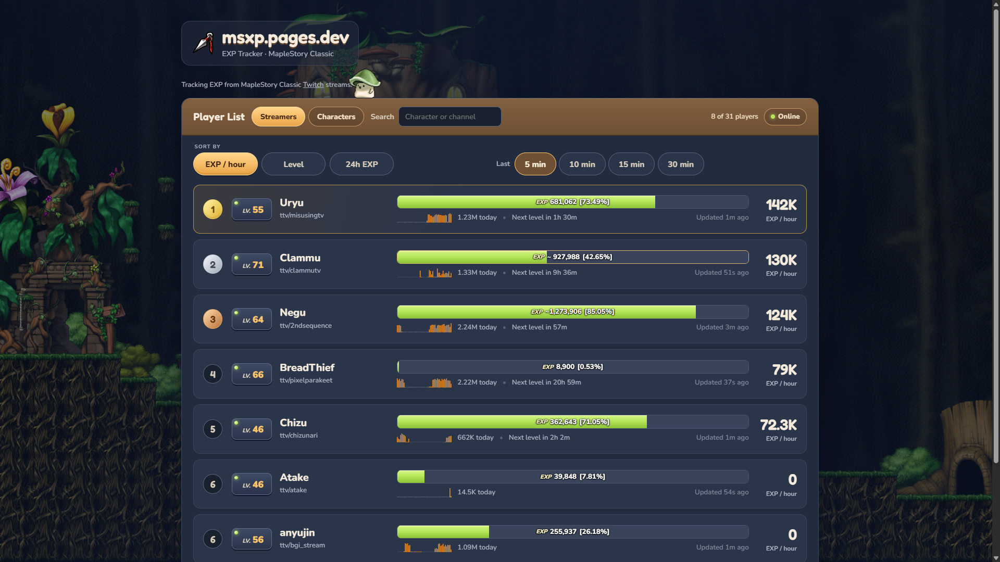
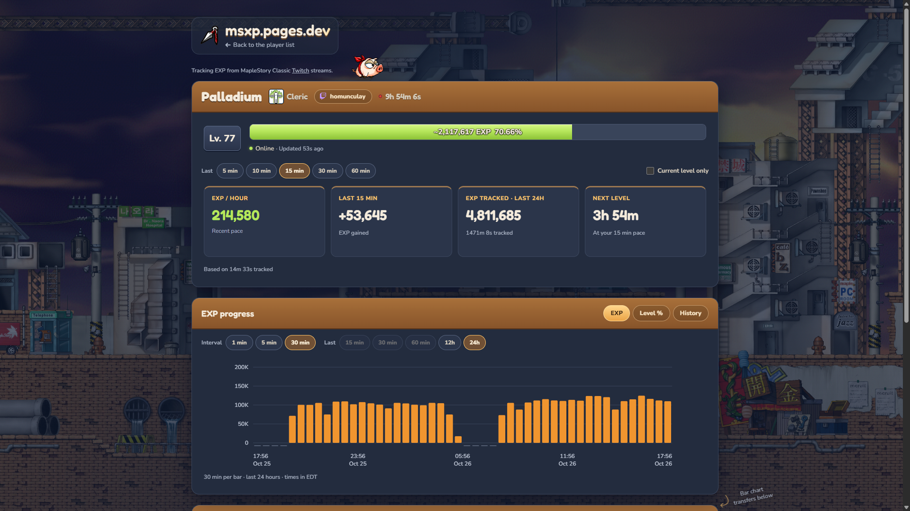
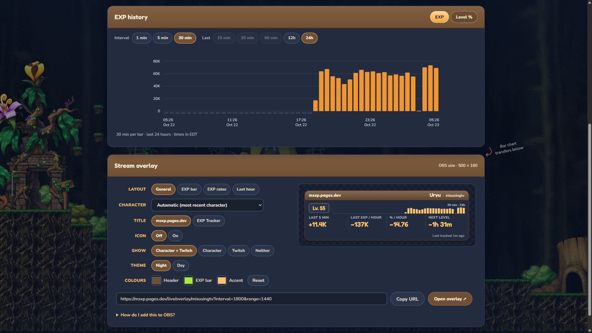

# MSXP: MapleStory Classic EXP tracker

MSXP watches MapleStory Classic streams on Twitch, reads the EXP bar from the stream,
and turns it into a live leaderboard: EXP per hour, time to the next level, 24-hour history
and a stream overlay for OBS. It can run for free on your own computer
or a small server. **See it live: [msxp.pages.dev](https://msxp.pages.dev)**

Nobody installs anything on the streamer's side: MSXP only watches the public stream.



*Leaderboard with player levels, EXP progress and recent EXP/hour.*

---

## Try it in 5 minutes

You need **[Python 3.11 or newer](https://www.python.org/downloads/)** (on Windows, tick
"Add python.exe to PATH" in the installer) and **[Git](https://git-scm.com/downloads)**.

```sh
git clone https://github.com/CabbageCanFly/msxp.git
cd msxp
```

| Windows (PowerShell) | macOS / Linux |
| --- | --- |
| `.\msxp install` | `./msxp install` |
| `.\msxp demo` | `./msxp demo` |

`install` sets everything up and tells you if anything is still missing. `demo` opens your
browser on a leaderboard with made-up players.

**Ctrl+C** is your best friend for stopping things in the terminal.

> Below, commands are written as `msxp ...`. Type `.\msxp ...` on Windows or `./msxp ...` on
> macOS/Linux, from the project folder.

## Track real streams

1. **Check your setup:** `msxp doctor`. Fix anything marked `[!!]`; it prints the exact command.
   Capturing needs **Tesseract** and **FFmpeg** besides Python.
2. **Create your tracker:** `msxp setup` (once).
3. **Add a streamer:** `msxp admin` opens the admin page. Choose **Add streamer**, type their
   Twitch name, tick **I have permission to capture this stream** and **Enable tracking**, then
   **Confirm settings**.
4. **Start tracking:** `msxp tracker`. Keep it running; your leaderboard is at
   <http://127.0.0.1:8765/>. Characters are recognized from the name shown in game, and readings
   appear while the streamer is live and playing MapleStory Classic.
5. **Add the overlay to OBS:** open the streamer's page on your leaderboard, pick a style under
   the overlay builder, click **Copy URL**, and follow **How do I add this to OBS?** right there.

Want the leaderboard to show who is live? Add free Twitch app keys to `.env` (next section).
With those keys, continuous tracking also checks live status and category about once a minute,
skipping playback while a stream is confirmed offline or outside MapleStory. Unknown or expired
status allows capture. `--any-category` permits other live categories while still skipping offline streams.



*Player profile with recent pace, next-level estimates and EXP history.*



*Overlay settings, preview and URL for an OBS Browser Source.*

## Commands

| Command | What it does |
| --- | --- |
| `msxp install` | Installs the Python packages and the OCR engine, then checks your setup |
| `msxp doctor` | Shows what is installed, missing or misconfigured, with the fix (alias `diag`) |
| `msxp demo` | The website with fictional players; nothing else needed |
| `msxp setup` | Creates your tracker database |
| `msxp admin` | Add streamers, confirm permission, start or pause tracking |
| `msxp tracker` | Captures the streams and serves your leaderboard |
| `msxp api` | Only the website, from an existing database, without capturing |
| `msxp dashboard` | Operator view: every capture's details per streamer, read-only (`msxp tracker` includes it at `/dev/streams`) |
| `msxp health` | Missed captures in the last hour, and why |
| `msxp cleanup` | Keeps only the last 24 hours of raw readings (`--apply` to actually delete) |
| `msxp test` | Runs the test suite |
| `msxp test-data` | Downloads only the required private test files; `--check` verifies installed files |
| `msxp where` | Where your settings, database, logs and backups are |
| `msxp logs` | Follow or browse logs; filter by time or text (on a server: `tracker`, `api` or `cleanup`) |
| `msxp sql` | Open the configured database in a read-only SQLite shell; optionally supply a quoted SQL query |
| `msxp server ...` | Runs any command on your server over SSH (see [Put it online](#put-it-online)) |

In a `git worktree` without its own `.venv`, msxp uses the main checkout's Python and OCR
environments (`msxp where` shows which) while still running the worktree's code.
| `msxp help` | This list, plus where your settings live |

Tool wrappers print the command they run and pass extra options to their underlying project tool
(for example `msxp tracker --check` only checks, without capturing). Logs and SQL use the options below.

Private regression inputs are optional for running the tracker. Maintainers with access to the private
test-data repository can run `msxp test-data`, then `msxp test`. Only missing required files are downloaded
and checked; the full research archive and a permanent data-repo clone are not kept locally.
See [private test data](docs/private-test-data.md) for recovery details.

### Search and browse server logs

```bash
msxp logs tracker --browse
msxp logs tracker --since "14 hours ago" --until "10 hours ago" --search "Streamer_A" --browse
msxp logs tracker --search "error" --lines 100
```

`--search` (alias `--grep`) matches a literal piece of text, ignoring case; punctuation is not a regular
expression. `--since` and `--until` accept relative times or dates such as `"2026-10-23 08:00:00"`.
Dates without a timezone use the server's local timezone. Time filters show history and exit;
add `--browse` for the scrollable journal viewer, or `--follow` to keep waiting for new entries.
Inside the viewer: `/text` then Enter searches, `n` finds the next match, `g`/`G` jump to the
top/bottom, and `q` quits. Left/right arrows scroll long lines.

Without time filters or `--browse`, logs start with the latest **50 entries**, then
follow new ones. `--lines 500` changes that initial count; `--no-follow` prints it and exits.
Time filters and `--browse` default to **all retained matching entries**; `--lines N` limits them,
and `--lines all` explicitly requests everything. History still depends on the server's journal retention.
When searching with a finite line count, historical results appear newest first. Live search filters
the initial recent-entry window and subsequent new entries; use `--lines all` to search all history.
Filtering and browsing require the systemd journal; local JSONL fallback only prints the newest operator
log's last `--lines` entries. It does not follow new entries.

From your PC, prefix the same command with `server`:

```bash
msxp server logs tracker --since "14 hours ago" --until "10 hours ago" --search "Streamer_A" --browse
```

### Query the database read-only

```bash
msxp sql
msxp sql "SELECT id, login FROM streamers;"
msxp sql --db /path/to/another-existing.sqlite3
msxp server sql
msxp server sql "SELECT id, login FROM streamers;"
```

The shell prints the database path, then accepts SQL ending in `;`. `.tables` lists tables,
`.schema diagnostic_attempts` shows a table's columns, and `.quit` exits. It opens the configured
database read-only, never creates a missing database, and uses SQLite safe mode to block opening
other files, attaching databases or running shell commands. User SQLite startup scripts are skipped.
Use the admin portal for corrections. This uses the existing `sqlite3` program (already installed
by the Ubuntu deployment installer); the wrapper explains how to install it if missing.

`msxp server sql` uses normal SSH authentication: you may be asked for your SSH password,
key passphrase or sudo password depending on your server setup. It needs no separate database password.

## Settings and secrets

Everything personal lives in **`.env`** in the project folder. `msxp install` creates it from
[`.env.example`](.env.example). Git ignores it, so it is never committed.

| Setting | Default | Meaning |
| --- | --- | --- |
| `MSXP_DATABASE` | `private/msxp/tracker.sqlite3` | Your tracker database |
| `MSXP_PORT` | `8765` | Your leaderboard website |
| `MSXP_ADMIN_PORT` | `8766` | The admin page (only reachable from your computer) |
| `MSXP_DASHBOARD_PORT` | `8767` | The operator dashboard (only reachable from your computer) |
| `MSXP_WORKERS` | `2` | Streams captured at the same time |
| `MSXP_PRELOAD_STREAMLINK` | `0` | Linux: set `1` to preload imports while keeping a fresh Streamlink child for every capture |
| `MSXP_SERVER` | none | Your server's SSH login, for `msxp server` (e.g. `root@203.0.113.7`) |
| `TWITCH_CLIENT_ID`, `TWITCH_CLIENT_SECRET` | none | Optional. Shows who is live. Create a free app at [dev.twitch.tv/console/apps](https://dev.twitch.tv/console/apps) |

Your data stays in the ignored `private/` folder. Keys never appear on the website or in overlay links.

On Linux, Streamlink import preloading is optional: set `MSXP_PRELOAD_STREAMLINK=1`
in `.env` (or `/etc/msxp/msxp.env` on the VPS), then restart the tracker. You can also
pass `--preload-streamlink` to `msxp tracker`. Each capture still opens and closes a
fresh playback connection with the same settings. Set the value back to `0` (or remove the CLI flag) and
restart the tracker to return to ordinary subprocess startup. See [capture performance](docs/capture-performance.md).

## Put it online

The live site runs the tracker on a small Ubuntu server, around the clock, and the website on
Cloudflare Pages. To set one up, start with [`deploy/install-ubuntu.sh`](deploy/install-ubuntu.sh)
and the [server guide](docs/vps-deployment.md). On the server, the project lives in `/opt/msxp/app`,
runs as the `msxp` user, and keeps its settings in `/etc/msxp/` (msxp reads them there too).
The wrapper reads `split.env`, then `roster.env`, then `msxp.env`; environment variables and the
project's `.env` override these files. Check `msxp where` or the path printed by `msxp sql` if unsure.

**Manage it from your own computer.** Put your server's SSH login in your local `.env`
(`MSXP_SERVER=root@203.0.113.7`), then:

| From your computer | What it does |
| --- | --- |
| `msxp server admin` | Opens the server's admin page in your browser through a private SSH tunnel; Ctrl+C closes it |
| `msxp server logs` | Follows the server's logs (`msxp server logs api` for just the website) |
| `msxp server sql` | Opens an interactive read-only SQLite shell on the server's configured database |
| `msxp server health` | Missed captures on the server in the last hour |
| `msxp server where` | Where everything lives on the server |
| `msxp server dashboard` | Opens the server's operator dashboard the same way; Ctrl+C closes it |
| `msxp server doctor` | Checks the server's setup |

The admin page and dashboard are never exposed to the internet: they only listen on the server
itself, and the tunnel brings them to your computer. The dashboard adds some CPU load while it is open. **Updating the server** after you push changes:
`ssh root@your-server "cd /opt/msxp/app && git pull --ff-only && systemctl restart msxp-api msxp-tracker"`.
The [docs index](docs/README.md) lists the deeper server guides.

## When something is off

- **`msxp` is not recognized:** run it from the project folder as `.\msxp` (Windows) or `./msxp`.
- **Tesseract or FFmpeg not found right after installing:** open a new terminal so it sees them.
- **"Port ... is in use":** it is probably already running. Or pick another port in `.env`.
- **A streamer shows no EXP:** they must be live *in the MapleStory Classic category* with the
  game's EXP bar visible. `msxp health` shows what each capture saw.
- **"Loading EXP…" right after a restart:** the website rebuilds every page; give it a few minutes.

## How it works

Every 20 seconds per stream: grab one video frame with Streamlink and FFmpeg, find the game's
status bar, read level and EXP with Tesseract and RapidOCR, and accept the reading only when the
numbers pass its checks. Readings go into SQLite, and a read-only web server turns them into the
leaderboard, history charts and overlays. When a reading is uncertain, MSXP rejects it and keeps
the last good one rather than guessing. The [docs index](docs/README.md) covers the design, accuracy tests and operations;
the previous, longer README is [here](docs/legacy-readme.md).

## Credits and license

MIT licensed ([LICENSE](LICENSE)). A non-commercial fan project, **not affiliated with Nexon**.

The Sleepywood and Kerning City backgrounds (`src/exp_tracker/web/sleepywood*.webp`, `kerning*.webp`)
and the monster sprites in `src/exp_tracker/web/mobs/` are MapleStory artwork © Nexon, rendered from
game data by [maplestory.io](https://maplestory.io) (GMS v55 and v83); the Slime is the animated WebP
from [meowdb.com](https://meowdb.com/msclassic/es/monsters/7). They only decorate the website.
Details: [website background sources](docs/website-background.md).
